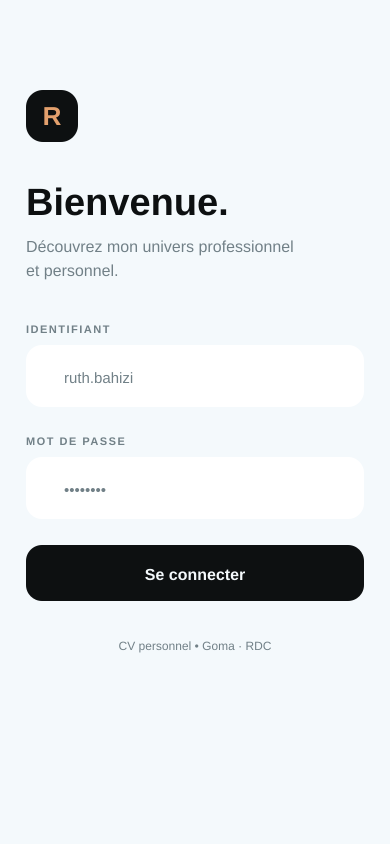
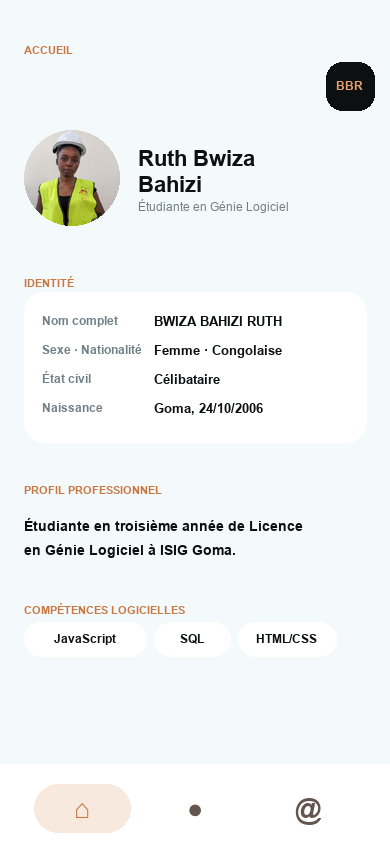
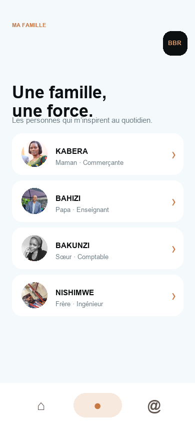
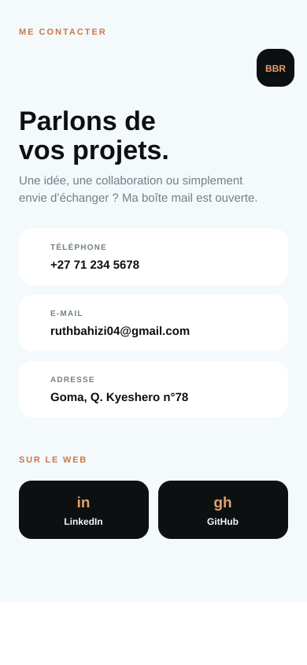

# cv_flutter_ruth

Application mobile Flutter présentant le profil professionnel, la famille et les coordonnées de Ruth Bwiza Bahizi.

## Direction artistique

Interface éditoriale, sobre et chaleureuse : encre `#0D1011`, papier `#F4F9FC` et accent cuivre `#C87843`.

## Écrans

### Connexion


### Accueil / CV


### Famille


### Contact


## Lancer le projet

```bash
flutter pub get
flutter run
```

Identifiant de démonstration : `ruth.kabeya` · mot de passe libre.
